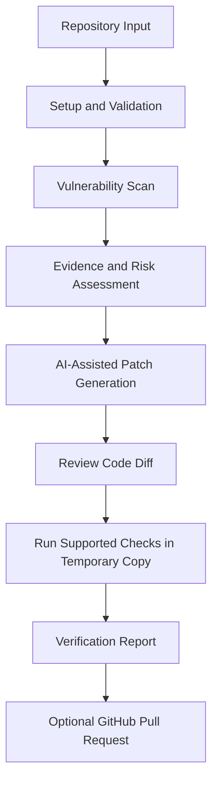
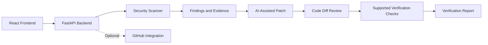

# PatchGuard 🛡️
### Evidence-Grounded Vulnerability Detection and AI-Assisted Patching

PatchGuard is a security-focused developer tool designed to detect code vulnerabilities, assess risks, suggest fixes using AI, and verify whether supported fixes resolve the detected issue.

## 🚨 Problem Statement

Developers often use separate tools to identify vulnerabilities, understand their impact, fix insecure code, and verify the results. This process can be time-consuming and difficult to manage.

PatchGuard aims to bring these steps into one workflow, helping developers move from vulnerability detection to remediation and verification.

## 🎯 Objectives

- Detect security vulnerabilities in source code.
- Provide evidence and explanations for identified issues.
- Assess vulnerability severity and risk.
- Generate AI-assisted code fixes.
- Display code changes for review.
- Run supported verification checks in a temporary working copy.
- Provide a report showing findings, proposed fixes, and test results.

## ✨ Key Features

| Feature | Status |
|---|---|
| FastAPI health and scanning endpoints | Implemented |
| Semgrep SQL injection detection for the tested pattern | Implemented |
| AI-assisted SQL injection fix for a separate test case | Validated separately |
| Code diff and patch review | Describe according to the current implementation |
| Automated verification | Limited to supported checks |
| Full UI-to-patch workflow | End-to-end integration not yet confirmed |
| Evidence-grounded RAG using live security sources | Planned / verify implementation |
| Automated benchmark and accuracy metrics | Not yet evaluated |
| GitHub pull request creation | End-to-end success not yet confirmed |

## 🏗️ How PatchGuard Works



The exact steps available depend on the current integration and configuration.

## 🔍 Example: SQL Injection

### Vulnerable Code

```python
query = f"SELECT * FROM users WHERE name = '{name}'"
cursor.execute(query)
```

This code inserts user input directly into an SQL query, which can allow SQL injection.

### Safer Code

```python
query = "SELECT * FROM users WHERE name = ?"
cursor.execute(query, (name,))
```

**Note:** The placeholder syntax depends on the database driver.

### Recorded Verification Evidence

- Semgrep reported zero findings for the tested pattern after the patch.
- `test_normal_lookup` passed.
- `test_sql_injection_blocked` passed.
- The original `vulnerable_demo.py` file remained unchanged.

These results validate the specific tested example, not the entire application.

## 🧠 Technology Stack

| Component | Technology |
|---|---|
| Frontend | React, Vite, Tailwind CSS |
| Backend API | Python, FastAPI |
| Static security analysis | Semgrep |
| AI-assisted analysis and patching | Groq-hosted language model through LangChain |
| Security rules | YAML |
| Version control integration | Git and GitHub |
| Testing | Python tests and supported security checks |

Verify the current dependencies and configuration before treating this table as the final installed stack.

## 🏛️ Architecture



## 📚 Planned Evidence and RAG Pipeline

Retrieval-Augmented Generation (RAG) can help connect vulnerability analysis to external security references instead of relying only on model-generated explanations.

Potential sources include:

- GitHub Security Advisories (GHSA)
- Open Source Vulnerabilities (OSV)
- National Vulnerability Database (NVD)
- Common Weakness Enumeration (CWE)
- CISA Known Exploited Vulnerabilities (KEV)

These sources should be described as integrated only after retrieval, source traceability, and evidence use have been implemented and tested.

## 📊 Evaluation

PatchGuard should be evaluated using reproducible test cases and clearly documented results.

Recommended metrics:

- Precision
- Recall
- F1-score
- False-positive rate
- False-negative rate
- Patch success rate
- Verification test pass rate

No accuracy or performance figures should be claimed until the evaluation has actually been executed. Synthetic dataset results, if used, should be identified separately from real-world performance.

## 🔐 Security Considerations and Limitations

- Never commit `.env` files, API keys, access tokens, or other secrets.
- Use `.env.example` for safe configuration documentation.
- Review AI-generated patches before accepting them.
- A temporary working copy is not equivalent to hardened container isolation.
- Only supported checks can verify a patch; passing one check does not prove that all vulnerabilities are removed.
- Dependency findings require accurate package versions and trustworthy advisory data.
- GitHub pull request creation should be considered successful only after an actual end-to-end test confirms it.
- Do not run intentionally vulnerable code against production systems.

## 🚀 Setup

1. Clone the repository.
2. Open the project directory.
3. Install dependencies according to the frontend and Python dependency manifests.
4. Configure required environment variables using `.env.example`, if provided.
5. Start the backend and frontend using the project's verified commands.
6. Test the available endpoints and scan workflow.

**Important:** Confirm the actual entry points, dependency files, and startup commands in the repository before publishing copy-paste commands.

## 🧪 Demo Guide

For a clear demonstration:

1. Submit a sample repository or supported code input.
2. Show a detected vulnerability and its supporting evidence.
3. Explain the risk in simple terms.
4. Display the suggested patch and code diff.
5. Run the supported verification checks.
6. Show the verification report, including the actual test results.

Use genuine screenshots or a short GIF of the working application to make the README more convincing.

## 🗺️ Roadmap

- [ ] Complete and test the full frontend-to-backend patch workflow.
- [ ] Improve security advisory retrieval and evidence traceability.
- [ ] Expand vulnerability coverage.
- [ ] Improve dependency version and advisory validation.
- [ ] Add reproducible benchmark datasets and evaluation reports.
- [ ] Strengthen patch verification and regression testing.
- [ ] Validate GitHub pull request creation end to end.
- [ ] Add screenshots and a reproducible demo guide.

## 🤝 Contributing

Contributions are welcome. Please test changes, document new dependencies, and avoid committing secrets or intentionally vulnerable production code.

## 📄 License

Add the license name and file only after choosing and committing a license for the project.
